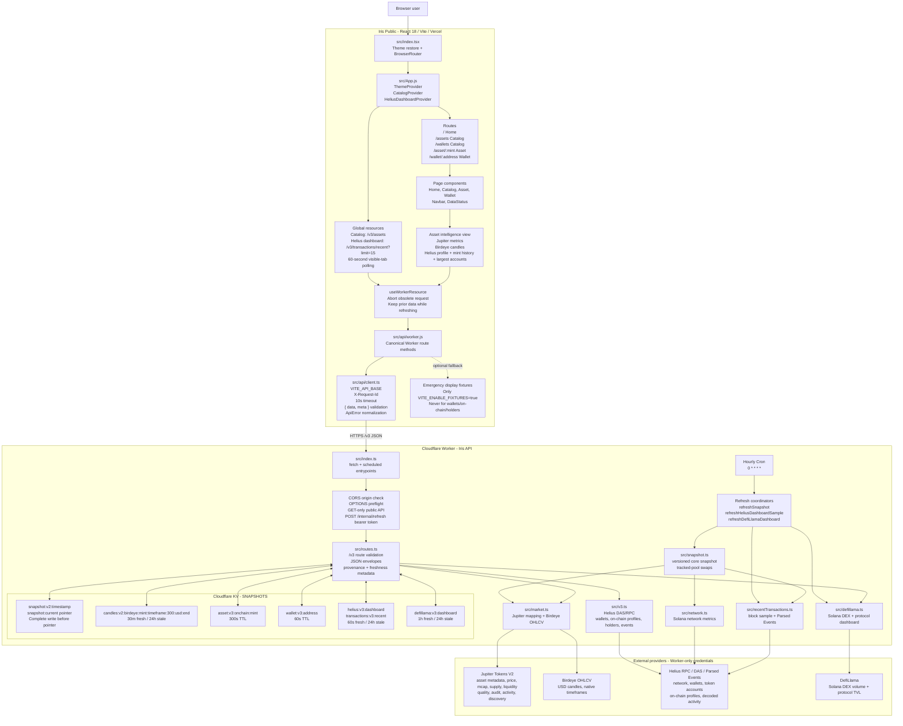
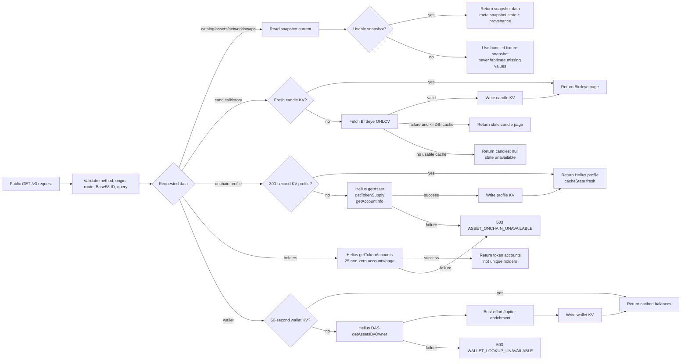

# Iris System Organigram

This document describes the application data path between `iris-frontend` and `iris-backend`. The browser calls only the Worker. Provider credentials and direct provider requests remain inside Cloudflare Workers. Hosted resources must be provisioned and verified separately; this source snapshot does not establish a live deployment.

## Frontend Request Paths

| Frontend surface           | Request(s)                                                                                              | Data shown                                                                                                          | Provider behind Worker                  |
| -------------------------- | ------------------------------------------------------------------------------------------------------- | ------------------------------------------------------------------------------------------------------------------- | --------------------------------------- |
| `CatalogProvider` / navbar | `GET /v3/assets`                                                                                        | Core catalog and Solana navbar market summary                                                                       | Jupiter snapshot                        |
| `HeliusDashboardProvider`  | `GET /v3/transactions/recent?limit=15` every 60 seconds while visible; reload once on visibility return | Recent sampled transactions, TPS, non-vote TPS, average fee                                                         | Helius                                  |
| `Home`                     | `/v3/catalogs`, `/v3/defillama` and selected asset detail                                               | Jupiter discovery, DefiLlama aggregate DEX/protocol cards                                                           | Jupiter, DefiLlama                      |
| `Asset`                    | `/v3/assets/mint/:mint?includeHistory=false`                                                            | Identity, market metrics, activity, audit indicators                                                                | Jupiter                                 |
| `Asset` chart              | `/v3/assets/mint/:mint/candles?timeframe=<native>`                                                      | USD OHLCV and volume                                                                                                | Birdeye                                 |
| `Asset` backward chart pan | Same candle route with `before=<unix-seconds>`                                                          | Earlier fixed 300-candle page                                                                                       | Birdeye                                 |
| `Asset` protocol panel     | `/v3/assets/mint/:mint/onchain`                                                                         | Token program, supply, authorities, mutability, extensions                                                          | Helius                                  |
| `Asset` intelligence panel | `/v3/assets/mint/:mint/transactions?limit=25`, `/distribution`                                          | Mint-address history and 20 largest token accounts, not a complete token-wide transfer ledger or unique-holder list | Helius                                  |
| `Wallet`                   | `/v3/wallets/:address`                                                                                  | Native/SPL/Token-2022 balances and priced subtotal                                                                  | Helius with optional Jupiter enrichment |
| `Wallet` activity          | `/v3/wallets/:address/transactions?limit=25&cursor=...`                                                 | Decoded public wallet events                                                                                        | Helius Parsed Events                    |

## API Contract And Compatibility

`/v3` is the canonical public API contract and is described completely in `openapi.yaml`. `/v1` and `/v2` remain operational but deprecated compatibility surfaces. The Worker package version, runtime API version, and OpenAPI `info.version` are kept identical and validated in CI. Public routes accept `GET`; `OPTIONS` supports browser preflight, and the operator-only `POST /internal/refresh` endpoint requires its separate refresh bearer token.

## Worker Route, Cache, And Failure Flow

## Scheduled Snapshot Flow

1. Cloudflare Cron runs hourly, or CI calls authenticated `POST /internal/refresh` after deployment.
2. `refreshSnapshot()` fetches Helius network metrics and configured reviewed-pool activity, then fetches the Jupiter market catalog and discovery lists.
3. The Worker writes a complete `snapshot:v2:<timestamp>` record to KV.
4. Only after the versioned snapshot write succeeds, the Worker updates `snapshot:current`. Production versioned snapshots and DefiLlama dashboard records expire after 24 hours. Dev sets `RETAIN_STALE_MARKET_DATA=true`: these records have no storage expiry and remain readable past 24 hours, still labelled stale with their original timestamps. Dev retains versioned snapshot records without automatic pruning. Birdeye candle and other on-demand cache limits are unchanged.
5. In parallel, best-effort refreshes update the Helius dashboard sample and DefiLlama dashboard. Their failure does not prevent core snapshot publication.
6. A core refresh failure keeps the last complete snapshot. Production falls back to the bundled fixture snapshot after the usable lifetime expires. Dev keeps its last valid market data; missing, malformed or future-dated records still fall back. This does not enable scheduled dev refresh or revive keys already deleted by KV expiry: one successful, separately authorized dev refresh is needed to populate retained records.

## Security Boundaries

| Boundary                 | Responsibility                                                                                                                              |
| ------------------------ | ------------------------------------------------------------------------------------------------------------------------------------------- |
| Browser                  | Holds only public `VITE_API_BASE`; never receives provider credentials or requests wallet signatures.                                       |
| Frontend client          | Adds a request ID, applies a 10-second timeout, validates the Worker envelope, and turns failures into displayable `ApiError` values.       |
| Cloudflare Worker        | Enforces allowed CORS origins, validates public request parameters, owns provider secrets, and prevents direct browser-to-provider traffic. |
| `POST /internal/refresh` | Requires `Authorization: Bearer <REFRESH_TOKEN>` and is not a public refresh endpoint.                                                      |
| Providers                | Receive requests only from the Worker using Worker-managed Helius, Jupiter, and Birdeye credentials.                                        |
| KV                       | Stores public market and public-chain cache data; no wallet keys, signatures, or user secrets are written.                                  |

## Source Files

### Frontend repository: `iris-frontend`

- `src/index.tsx` - React bootstrap and theme restore.
- `src/App.tsx` - provider tree, route definitions and focus restoration.
- `src/api/client.ts` - HTTP envelope, timeout, and error behavior.
- `src/api/worker.ts` - Worker route methods and controlled fixture fallback.
- `src/hooks/useWorkerResource.ts` - component request lifecycle.
- `src/contexts/CatalogContext.tsx` - catalog resource.
- `src/contexts/HeliusDashboardContext.tsx` - visible-tab network/transaction resource.
- `src/components/Asset.tsx` - market, candles, and Helius token-intelligence composition.

### Worker repository: `iris-backend`

- `src/index.ts` - Cloudflare fetch/scheduled entrypoints and authenticated refresh.
- `src/routes.ts` - public `/v3` dispatcher and parameter validation.
- `src/snapshot.ts` - versioned core snapshot publication.
- `src/market.ts` - Jupiter catalog mapping and Birdeye candle retrieval.
- `src/v3.ts` - Helius wallet, event, on-chain profile, and holder implementations.
- `src/recentTransactions.ts` - short-lived Helius dashboard cache.
- `src/network.ts` - Helius network-metric calculation.
- `src/defillama.ts` - independently cached DeFi analytics.
- `src/constants.ts` - cache keys, TTLs, page sizes, and supported limits.

## Operator documentation

The frontend repository owns the [environment and release runbook](https://github.com/benhammoush/iris-frontend/blob/main/ENVIRONMENTS.md)
and its dated [release evidence](https://github.com/benhammoush/iris-frontend/blob/main/RELEASE-NOTES.md).
This architecture is a source-level description, not a live inventory or proof
of deployed configuration. The runbook's [old-infrastructure retirement
section](https://github.com/benhammoush/iris-frontend/blob/main/ENVIRONMENTS.md#old-infrastructure-retirement)
tracks the separate provider/resource retirement work; this document does not
authorize that work.
