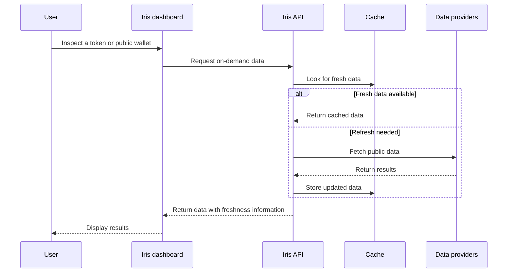

# Iris — backend

A read-only API for Solana market data, token details and public-wallet activity.
It powers the [Iris dashboard](https://github.com/benhammoush/iris-frontend)
without requiring wallet connections or signatures for public browsing.

## Tech stack

| Layer               | Technology                          |
| ------------------- | ----------------------------------- |
| API runtime         | TypeScript, Cloudflare Workers      |
| Cache and snapshots | Cloudflare KV                       |
| Data providers      | Helius, Jupiter, Birdeye, DefiLlama |
| API contract        | OpenAPI                             |
| Testing             | Node.js test runner, AJV            |

## System design

This illustrates on-demand reads. Scheduled jobs also publish complete market
snapshots in the background; snapshot-backed requests read those published results
rather than refreshing providers on demand.

## Responsibilities

- Provide market discovery, token details, charts and public-wallet balances/activity.
- Manage provider access, caching and versioned snapshots.
- Preserve freshness, provenance and unavailable values instead of treating missing data as zero.

Provider credentials remain server-side. The public API does not sign transactions
or move funds. Private watchlists are a separate, disabled-by-default feature;
their authenticated account lifecycle and hosted activation are not implied by
public browsing support.

## Integration

The dashboard requests data through the Worker rather than contacting chain or
pricing providers directly. Responses include data and metadata so consumers can
distinguish fresh, stale and unavailable results.

See [the API specification](openapi.yaml) for routes, parameters, authentication
requirements and response formats.

See [the architecture](docs/architecture.md) and
[private-watchlist specification](docs/spec/watchlists.md) for the system boundaries.
